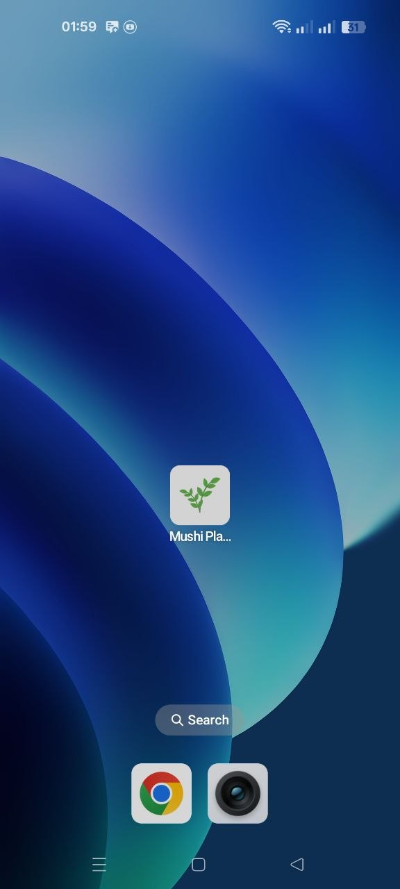
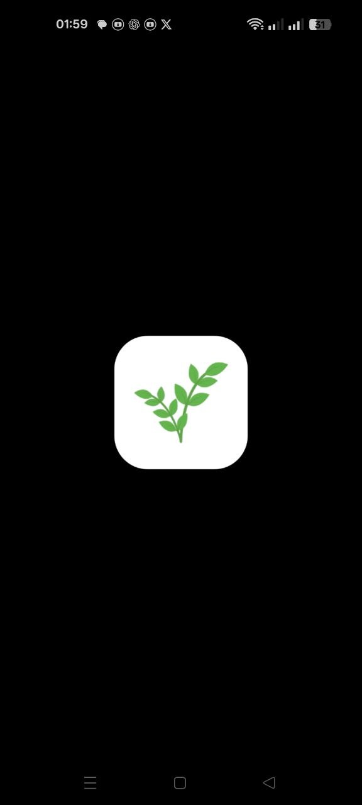
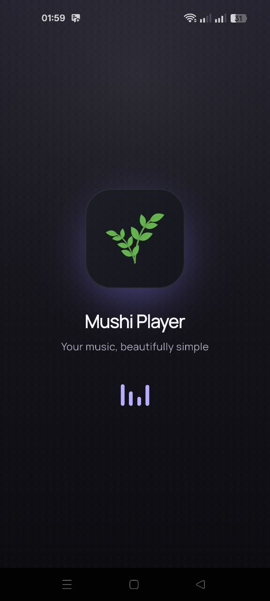
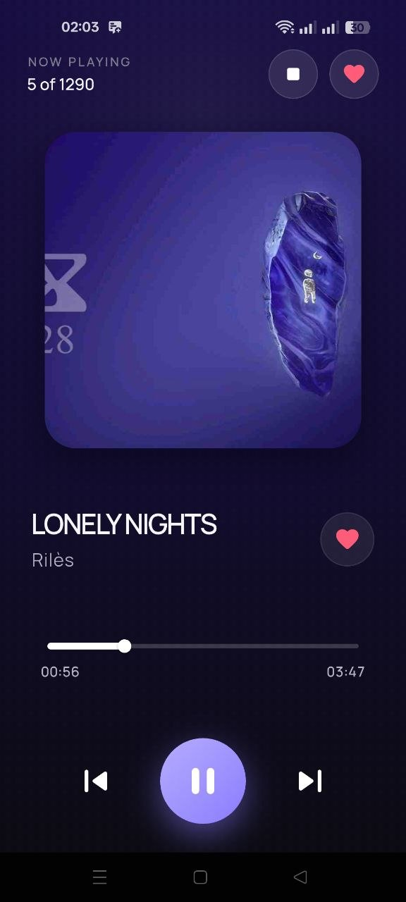
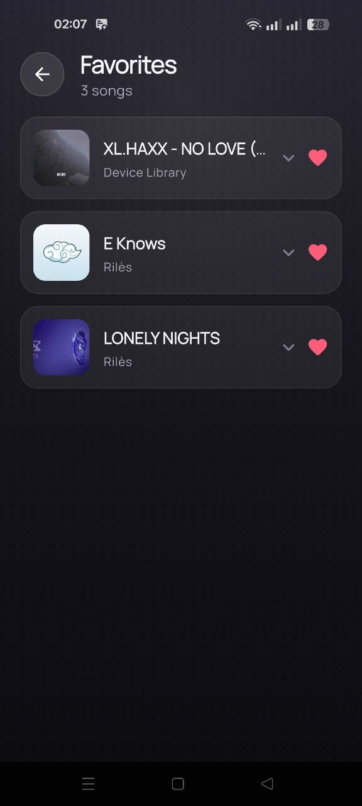
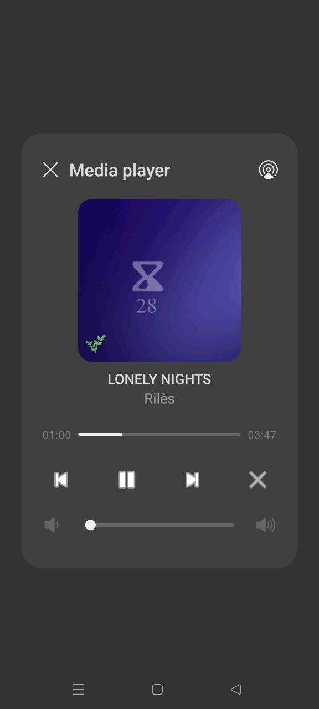
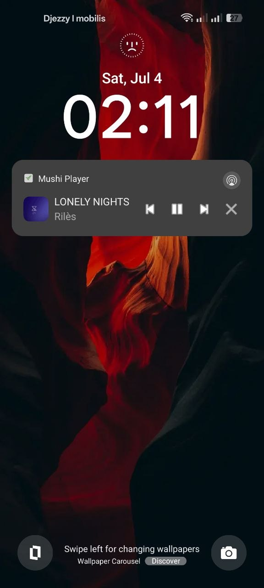

<div align="center">

<!-- 📸 Replace with your app logo (assets/flower-pot.png works nicely) -->


# 🎵 Mushi Player

**A lightweight Android music player built with Flutter — plays your on-device MP3s with true native background playback.**

<!-- 📸 Optional: drop a wide hero/banner image here -->
<!--  -->

[](https://flutter.dev)
[](https://dart.dev)
[](https://kotlinlang.org)
[](#)
[](LICENSE)

</div>

---

## 📖 Overview

**Mushi Player** plays the MP3 files already on your device and drives all playback through a **native Android foreground service**, so audio keeps running in the background with full lock-screen, notification, Bluetooth, and Android Auto controls.

Unlike most Flutter audio apps, Mushi Player uses **no Dart audio package** — playback runs natively via `android.media.MediaPlayer` inside a foreground service, while Flutter only sends commands and renders state over platform channels.

---

## 📱 Screenshots

A quick walkthrough of the app, from launch to playback and system integration.

<div align="center">

### Launch experience

| Home-screen icon | Native launch | Splash |
|:----------------:|:-------------:|:------:|
|  |  |  |

### In the app

| Now Playing | Favorites |
|:-----------:|:---------:|
|  |  |

### Background & system integration

| Notification controls | Lock-screen controls |
|:---------------------:|:--------------------:|
|  |  |

</div>

---

## ✨ Features

- 🎧 Plays the MP3 files stored on your device (scanned from `MediaStore`)
- ⏯️ Play / Pause / Next / Previous controls
- 📱 Native background playback via an Android foreground service
- 🔒 Lock-screen & notification media controls (`MediaStyle` + `MediaSessionCompat`)
- 🎛️ Bluetooth / headset / Android Auto transport support
- 🤝 Hardware media-button support (even after the process is killed)
- 📳 **Shake to toggle** play/pause (accelerometer driven)
- ⭐ Favorites, stored locally with SQLite (`sqflite`)
- 🎨 Dynamic UI accent colors extracted from album art (`palette_generator`)
- 🖼️ Embedded album-art extraction
- ⏩ Seek / real-time progress tracking

---

## 🛠️ Tech Stack

| Layer | Technology |
|-------|------------|
| UI / App | Flutter, Dart |
| Native playback | Kotlin, `MediaPlayer`, foreground `Service`, `MediaSessionCompat` |
| Bridge | Flutter `MethodChannel` + `EventChannel`s |
| Local storage | `sqflite` (favorites) |
| Styling | `google_fonts`, `palette_generator` |
| Permissions | `permission_handler` |

---

## 🏗️ Architecture

Flutter and Android communicate strictly through platform channels — the UI never touches the service directly.

```
┌────────────────────┐   MethodChannel (commands)    ┌────────────────────────┐
│      Flutter UI     │ ────────────────────────────▶ │   Android native side  │
│  (player, favorites)│                                │                        │
│                     │ ◀──────────────────────────── │  MusicService.kt       │
│ music_service_bridge│   EventChannels (state, shake) │  (MediaPlayer +        │
└────────────────────┘                                │   MediaSessionCompat)  │
                                                       └────────────────────────┘
```

### Android side (`android/app/src/main/kotlin/com/gennaro16/mushiplayer/`)

- **`MainActivity.kt`** — entry point. Requests notification (Android 13+) and media permissions, then wires up the channels: a `MethodChannel` for commands (`startService`, `play`, `pause`, `next`, `previous`), a `shakeDetector` `EventChannel` for accelerometer shake events, and a `playbackState` `EventChannel` to stream state back to Flutter.
- **`MusicService.kt`** — the foreground service. Queries `MediaStore` for on-device MP3s, plays them with `MediaPlayer`, shows an ongoing `MediaStyle` notification, owns a `MediaSessionCompat` (lock screen, Bluetooth, Android Auto), extracts album art, handles seek, and mirrors playback state up to Flutter.
- **`MusicBridge.kt`** — small helper holding the `MethodChannel` and the `playbackState` sink so the service can call back into Flutter on the main thread.
- **`MediaLibrary.kt`** — device media querying helpers.

### Flutter side (`lib/`)

- **`main.dart`** — initializes the bridge before `runApp`.
- **`services/music_service_bridge.dart`** — the single bridge class; sends commands, requests permissions, and exposes callbacks (`registerSongListCallback`, `registerShakeCallback`, `registerPlaybackStateCallback`).
- **`screens/`** — `splash_screen.dart`, `player_screen.dart`, `favorites_screen.dart`.
- **`controllers/`, `repositories/`, `models/`, `widgets/`, `theme/`** — favorites logic (SQLite), the `Song` model, reusable widgets, and theming.

### Manifest

`AndroidManifest.xml` declares the service with `foregroundServiceType="mediaPlayback"` and the required permissions: `FOREGROUND_SERVICE`, `FOREGROUND_SERVICE_MEDIA_PLAYBACK`, `POST_NOTIFICATIONS`, `READ_MEDIA_AUDIO` (Android 13+) and `READ_EXTERNAL_STORAGE` (`maxSdkVersion=32`). `MainActivity` uses `singleTask` launch mode and a `MediaButtonReceiver` handles hardware/Bluetooth buttons.

---

## 🚀 Getting Started

### Prerequisites

- [Flutter SDK](https://docs.flutter.dev/get-started/install) (Dart SDK `^3.10.8`)
- Android device or emulator with some MP3 files on storage

### Run

```bash
# Clone the repo
git clone https://github.com/gennaro-16/Mushi-Player.git
cd Mushi-Player

# Fetch dependencies
flutter pub get

# Run on a connected device / emulator
flutter run
```

### Build a release APK

```bash
flutter build apk --release
```

On first launch, grant the audio/media and notification permissions so the player can read your files and show playback controls.

---

## 📂 Project Structure

```
lib/
├── main.dart                     # App entry, initializes the native bridge
├── controllers/                  # Favorites controller
├── models/                       # Song model
├── repositories/                 # Favorites persistence (SQLite)
├── screens/                      # Splash, Player, Favorites
├── services/                     # Native bridge + artwork palette
├── theme/                        # App theming
└── widgets/                      # Reusable UI components

android/app/src/main/kotlin/com/gennaro16/mushiplayer/
├── MainActivity.kt               # Channels + permissions
├── MusicService.kt               # Foreground playback service
├── MusicBridge.kt                # MethodChannel / event sink helper
└── MediaLibrary.kt               # MediaStore querying
```

---

## 🔮 Roadmap

- [ ] Online streaming integration
- [ ] Offline caching
- [ ] Equalizer system
- [ ] Cloud-based playlist synchronization
- [ ] iOS native playback parity

---

## 🤝 Contributing

Contributions are welcome — see [CONTRIBUTING.md](CONTRIBUTING.md).

## 📄 License

This project is licensed under the terms of the [LICENSE](LICENSE) file.

---

<div align="center">
Made with ❤️ and Flutter by <a href="https://github.com/gennaro-16">gennaro-16</a>
</div>
